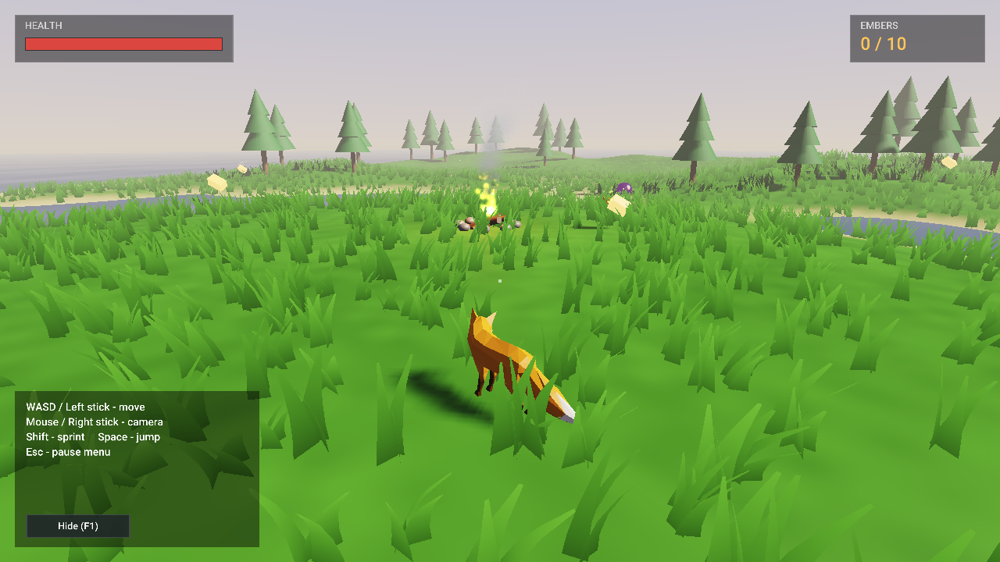
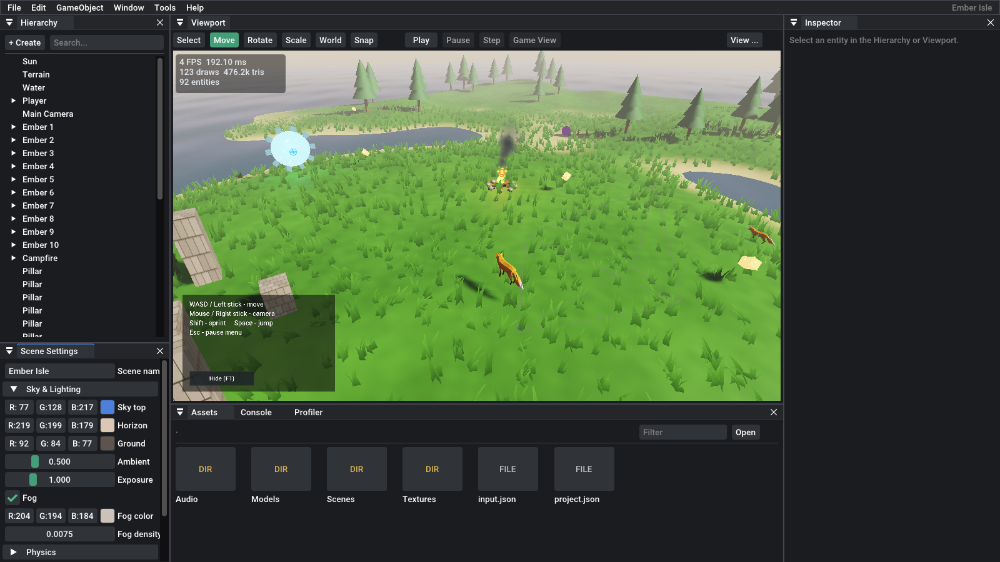
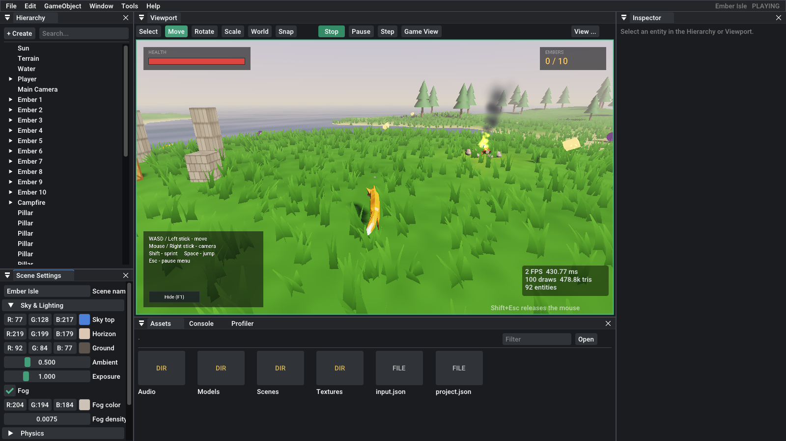
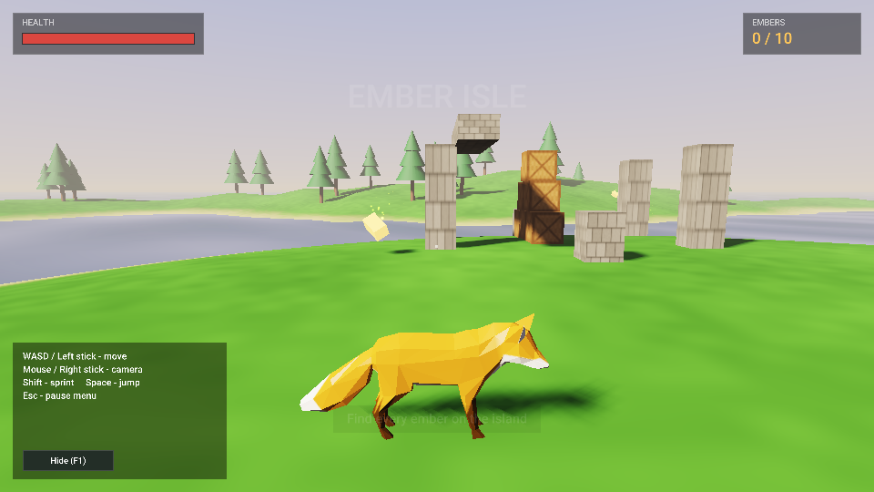
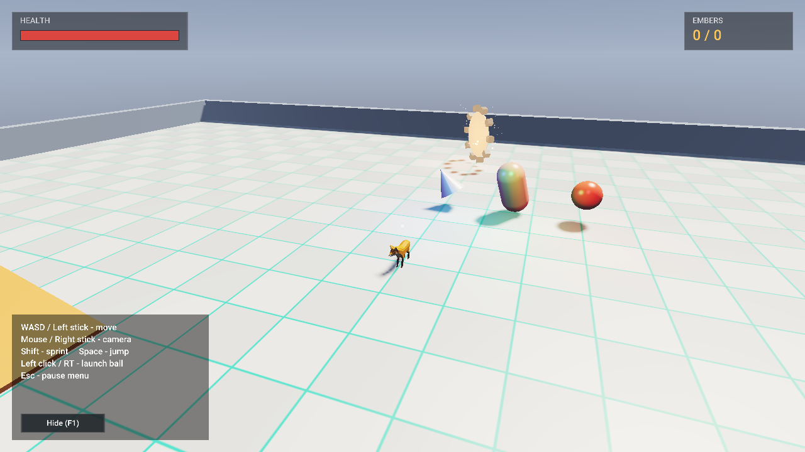
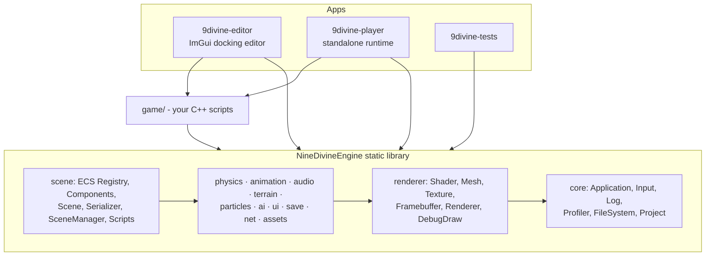
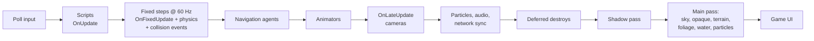

<div align="center">

# 9divine

**A 3D game engine and editor written from scratch in C++17 and OpenGL 3.3.**

ECS architecture · Forward renderer with shadows · Physics · Skeletal animation · 3D audio · Terrain & foliage · Navigation & AI · Game UI · Save system · UDP multiplayer · One-click game export



</div>

---

## Highlights

| | |
|---|---|
|  |  |
| **Editor** – dockable panels, gizmos, mouse picking, undo/redo, asset drag & drop | **Play mode** – run the game inside the editor, stop to restore the scene |
|  |  |
| **Skeletal animation** – glTF skins, blend spaces, state machines | **Physics arena** – stacking, ramps, moving platforms, projectiles |

The repository includes **Ember Isle**, a small game built entirely with the engine: explore a procedurally generated island, collect embers, avoid the shades that hunt you, save at campfires, and unlock a portal to a physics playground. It can be played solo or with a friend over the network.

## Features

| System | What's implemented |
|---|---|
| **Rendering** | Forward Blinn-Phong renderer, directional light with PCF shadow maps (texel-snapped), 8 point + 4 spot lights, procedural sky, distance fog, ACES tone mapping, frustum culling, GPU skinning, instancing, entity-ID picking buffer |
| **Entity Component System** | Custom sparse-set ECS with versioned handles, stable component storage, multi-component views, parent/child hierarchy |
| **Input** | Keyboard, mouse, up to 4 gamepads, named actions & axes, runtime rebinding with JSON persistence |
| **Scenes** | Human-readable JSON scenes, scene switching at safe points, deep entity duplication with UUID remapping |
| **Assets** | glTF/GLB (meshes, materials, skins, animations), OBJ, FBX, PNG/JPG/TGA, WAV/MP3/FLAC; caching and hot reload on file change |
| **Scripting** | C++ gameplay scripts with lifecycle callbacks (`OnCreate`, `OnUpdate`, `OnFixedUpdate`, `OnLateUpdate`, collision/trigger events, `OnGUI`) and reflected fields editable in the inspector |
| **Physics** | Impulse solver with friction & restitution, sphere and oriented-box colliders, heightfield terrain collision, triggers, raycasts, overlap queries, kinematic bodies, sort-and-sweep broad phase, fixed 60 Hz timestep |
| **Animation** | Skeletal animation with slerp sampling, cross-fades, 1D blend spaces with phase sync, parameter-driven state machines, root motion |
| **Audio** | miniaudio backend, 2D and 3D spatial sound, streamed music, master/music/SFX buses, listener component |
| **Terrain** | Procedural fBm heightmaps, in-editor sculpting (raise/lower/smooth/flatten), height/slope-based texturing, wind-animated instanced grass, scattered trees, animated water |
| **Game UI** | Immediate-mode HUD API (panels, text, buttons, progress bars, images, world-space labels) plus retained UI components editable in the editor |
| **Navigation & AI** | Grid nav-mesh baking from terrain and colliders, A* with path smoothing, nav agents, finite state machines, behaviour trees |
| **Particles** | CPU simulation, instanced billboards, additive/alpha blending with sorting, presets (fire, smoke, sparks, magic, rain, dust) |
| **Debugging** | CPU profiler with per-system timings, frame-time graph, draw/triangle/memory stats, debug line drawing, collider and nav-grid overlays |
| **Build / Export** | Packages the runtime, engine data and project into a standalone folder from the editor or the command line |
| **Save system** | Key/value save slots, checkpoints that snapshot every `Saveable` entity, restore across scene reloads |
| **Networking** | Client/server over UDP with handshake, timeouts, ping, transform replication with interpolation, remote player spawning, custom JSON messages |
| **Tests & CI** | 20 headless unit tests (CTest) covering ECS, serialization, physics, terrain, navigation, AI, animation, input and saves; GitHub Actions builds on Windows and Linux |

## Getting started

### Requirements
- CMake 3.16+
- A C++17 compiler: **Visual Studio 2022**, GCC 9+ or Clang 10+
- A GPU with OpenGL 3.3
- Linux only: `sudo apt install build-essential cmake libx11-dev libxrandr-dev libxinerama-dev libxcursor-dev libxi-dev libgl-dev`

All third-party libraries are vendored in `third_party/`, so no package manager or internet connection is needed.

### Build

**Windows (Visual Studio 2022)**
```bat
cmake -S . -B build
cmake --build build --config Release
build\bin\9divine-editor.exe
```
Or open the folder in Visual Studio ("Open a local folder") and pick `9divine-editor.exe` as the startup item.

**Linux**
```bash
cmake -S . -B build -DCMAKE_BUILD_TYPE=Release
cmake --build build -j
./build/bin/9divine-editor
```

Run the tests with `ctest --test-dir build -C Release --output-on-failure`.

### Play the demo
- **Editor:** `9divine-editor` opens the Ember Isle project. Press **Play** (Ctrl+P).
- **Standalone:** `9divine-player` runs the game directly.
- **Multiplayer:** start one copy with `9divine-player --host` and another with `9divine-player --join 127.0.0.1` (or use the in-game pause menu).

| Action | Keyboard / Mouse | Gamepad |
|---|---|---|
| Move | WASD | Left stick |
| Camera | Mouse | Right stick |
| Jump / Sprint | Space / Shift | A / L3 |
| Launch ball (arena) | Left click | RT |
| Pause menu | Esc | Start |
| Stats overlay / Screenshot | F3 / F12 | |

### Editor controls
| | |
|---|---|
| Fly camera | Hold right mouse + WASD/QE (wheel changes speed) |
| Orbit / Pan / Zoom | Alt + left drag / middle drag / wheel |
| Gizmos | Q none, W move, E rotate, R scale (Ctrl to snap) |
| Focus selection | F or double-click in the hierarchy |
| Undo / Redo | Ctrl+Z / Ctrl+Y |
| Duplicate / Delete | Ctrl+D / Del |
| Save scene | Ctrl+S |
| Release mouse from a running game | Shift+Esc |

## Writing gameplay code

Scripts are C++ classes in `game/src`. Every `.cpp` there is compiled into both the editor and the player, and `ND_SCRIPT` registers the class so scenes can reference it by name.

```cpp
#include <nd/9divine.h>
using namespace nd;

class Coin : public ScriptableEntity {
public:
    float spinSpeed = 120.0f;                       // shows up in the inspector

    void Reflect(FieldVisitor& v) override { v.Float("Spin Speed", spinSpeed); }

    void OnUpdate(float dt) override {
        Transform().rotation *= glm::angleAxis(glm::radians(spinSpeed * dt), vec3(0, 1, 0));
    }

    void OnTriggerEnter(Entity other) override {
        if (other.Get<TagComponent>().tag != "Player") return;
        Audio::PlayOneShot("Audio/coin.wav");
        SaveGame::SetInt("coins", SaveGame::GetInt("coins") + 1);
        DestroySelf();
    }

    void OnGUI() override {
        UI::Text({ 40, 40 }, "Coins: " + std::to_string(SaveGame::GetInt("coins")), 36);
    }
};
ND_SCRIPT(Coin)
```

Then add a **Scripts** component in the inspector and pick `Coin`. See [`game/src`](game/src) for complete examples: a third-person controller, an orbit camera, a state-machine enemy, a behaviour-tree animal, checkpoints and a ball launcher.

## Architecture



A frame of the running game:



A deeper walkthrough of each subsystem and the design decisions behind it is in **[docs/ARCHITECTURE.md](docs/ARCHITECTURE.md)**.

## Repository layout

```
engine/src/nd/      the engine (core, scene, renderer, physics, animation, audio, ai, ...)
editor/src/         the editor application
player/src/         the standalone runtime used by exported games
game/src/           gameplay scripts + the demo project generator
assets/             engine shaders and fonts
projects/Demo/      the Ember Isle sample project (scenes, models, audio, textures)
tests/              unit tests
third_party/        vendored libraries
docs/               architecture notes, roadmap, screenshots
```

## Command line

| Command | |
|---|---|
| `9divine-editor [projectDir]` | Open a project (creates an empty one if the folder is new) |
| `9divine-editor --play` | Open and immediately enter play mode |
| `9divine-editor [projectDir] --export <dir>` | Build a standalone game without opening the editor |
| `9divine-player [projectDir]` | Run a project |
| `9divine-player --host [port]` / `--join <ip> [port]` | Start or join multiplayer |
| `9divine-player --build-demo <dir>` | Regenerate the sample project |
| `--width W --height H --fullscreen --no-vsync` | Window options |
| `--screenshot file.png --screenshot-frame N` | Save frame N and exit (automated testing) |

## Roadmap

Ideas for what comes next are in [docs/ROADMAP.md](docs/ROADMAP.md) — including rotational rigid-body dynamics, deferred/PBR rendering, a recast-style polygon nav mesh, binary network snapshots with client-side prediction, and C# scripting.

## Credits

- Fox model by PixelMannen (CC0), rigging & animation by tomkranis (CC BY 4.0), glTF conversion by @AsoboStudio and @scurest (CC BY 4.0) — from the Khronos [glTF Sample Assets](https://github.com/KhronosGroup/glTF-Sample-Assets) (`Models/Fox`). License file: `projects/Demo/Models/Fox/LICENSE.md`.
- Fonts: Roboto and Cousine (Apache License 2.0), bundled with Dear ImGui.
- Sounds, textures and terrain in the demo are generated procedurally.
- Libraries: GLFW, glad, GLM, Dear ImGui, ImGuizmo, stb, cgltf, tinyobjloader, ufbx, miniaudio, nlohmann/json. See [THIRD_PARTY_NOTICES.md](THIRD_PARTY_NOTICES.md).

## License

[MIT](LICENSE)
