<div align="center">

# Euphoria Engine

**A 3D game engine and editor written from scratch in C++17 and OpenGL 3.3.**

ECS architecture · PBR + HDR renderer · Cascaded soft shadows · Reflections · Bloom & SSAO · Path tracing mode · Toon shading & ink outlines · Event scripting · Doors & screen fades · Physics · Skeletal animation · 3D audio · Terrain & foliage · Navigation & AI · Game UI · Save system · UDP multiplayer · One-click game export

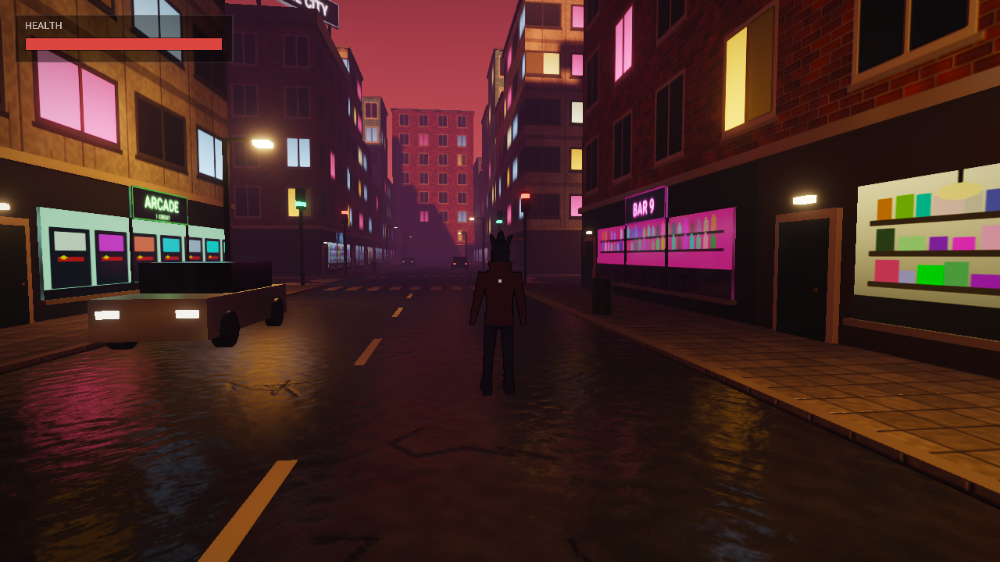

</div>

---

## Highlights

| | |
|---|---|
| 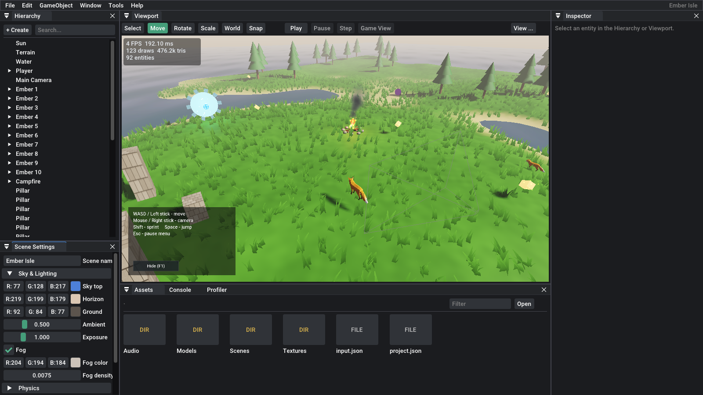 | 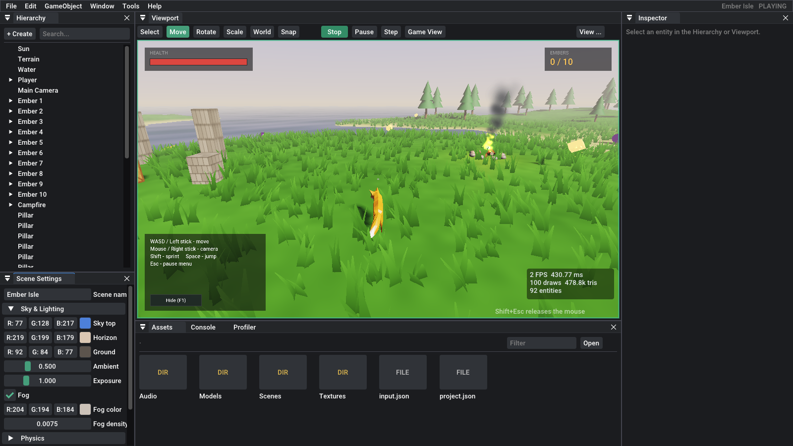 |
| **Editor** – dockable panels, gizmos, mouse picking, undo/redo, asset drag & drop | **Play mode** – run the game inside the editor, stop to restore the scene |
| 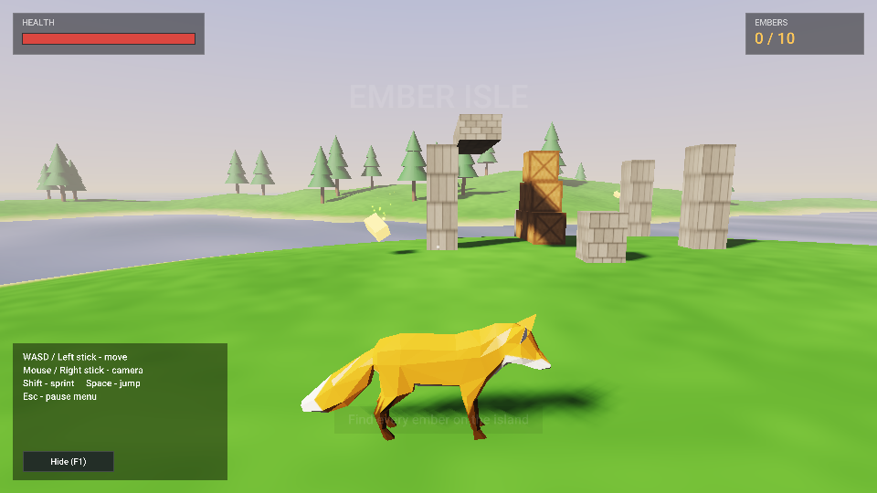 | 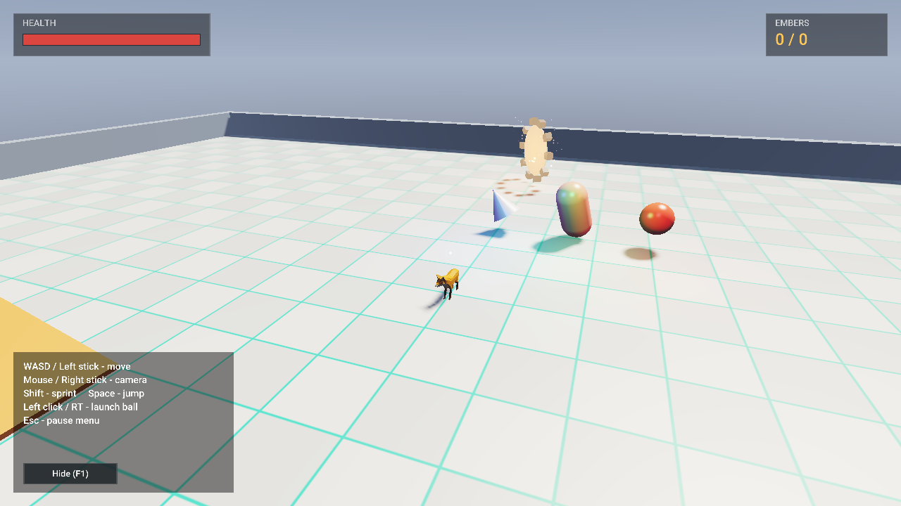 |
| **Skeletal animation** – glTF skins, blend spaces, state machines | **Physics arena** – stacking, ramps, moving platforms, projectiles |

### Graphics

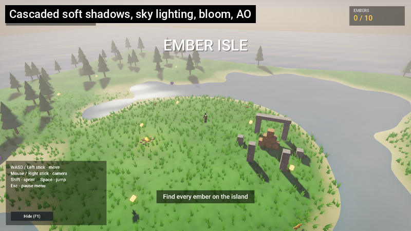

Physically based materials (metallic/roughness, normal maps) lit in HDR, with cascaded soft shadows out to 150 m, ambient light from the sky, a live reflection cubemap for glossy surfaces and water, and a post stack: SSAO, bloom, filmic tone mapping, color grading and FXAA. Identical objects are batched into single instanced draws automatically. All of it is tunable per scene under **Scene Settings → Post Processing**.

### Ray tracing

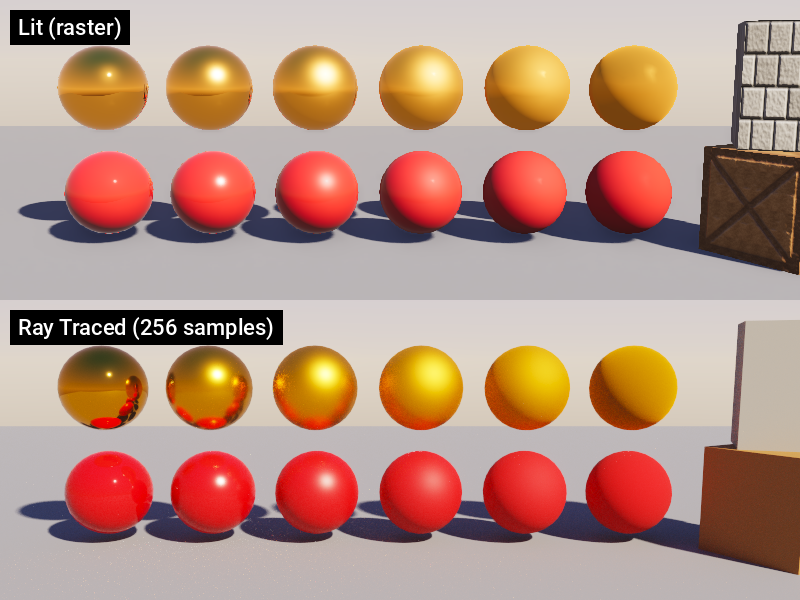

Click **Lit / Ray Traced** in the viewport toolbar (or press **F4** in a game, or run `euphoria-player --ray-traced`) to switch the same scene to a GPU path tracer. It traces soft shadows, light bouncing between surfaces and true reflections, and refines the longer the camera stays still. It uses the same lights and units as the rasterizer, so the two modes match in brightness.

### Toon shading

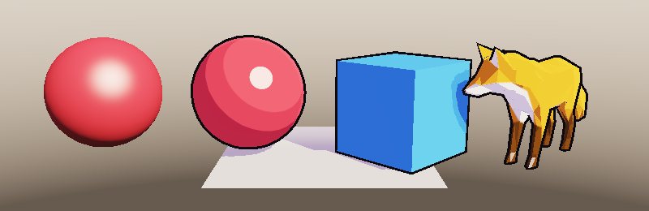

*Left to right: standard Blinn-Phong, the same sphere with toon shading, a cube whose outline stays closed at the hard edges, and the skinned glTF fox.*

Tick **Toon shading** and/or **Outline** on any Mesh Renderer. Lighting snaps into flat bands (2-8), the darkest band is tinted instead of going grey, and an inverted-hull pass draws a pixel-width ink line around the silhouette. From code:

```cpp
auto& mr = entity.Get<MeshRendererComponent>();
mr.toon = true;
mr.toonBands = 3;                         // light steps
mr.toonShadowColor = { 0.45f, 0.40f, 0.62f };
mr.outline = true;
mr.outlineWidth = 3.0f;                   // pixels
```

How it works is in [docs/ARCHITECTURE.md](docs/ARCHITECTURE.md#toon-shading-and-outlines).

### Playable characters from Blender

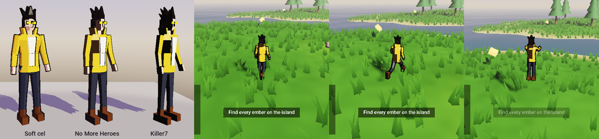

*The Hero in the three toon presets, and walking, sprinting and jumping in Ember Isle.*

The player in the demo and the 3D Starter is the **Hero**, a low-poly human built by [`tools/blender/euphoria_hero.py`](tools/blender/euphoria_hero.py). Run it in Blender to get an editable mesh, rig and Idle/Walk/Run/Jump actions, or run it with plain Python to write the `.glb` directly.

Any Blender character works the same way. Name your actions *Idle, Walk, Run, Jump*, export a `.glb`, drop it on the player's model and click **Animator → Auto-setup locomotion**. The player controller then drives a speed-based idle→walk→run blend and a jump state. The full workflow, with export settings, is in **[docs/BLENDER.md](docs/BLENDER.md)**.

### The demo: Divine City

The repository includes a small game built entirely with the engine. It starts in **Divine City**, a city block at dusk: wet streets that reflect the neon, lit windows, street lamps, parked cars, and a door on every shop front.

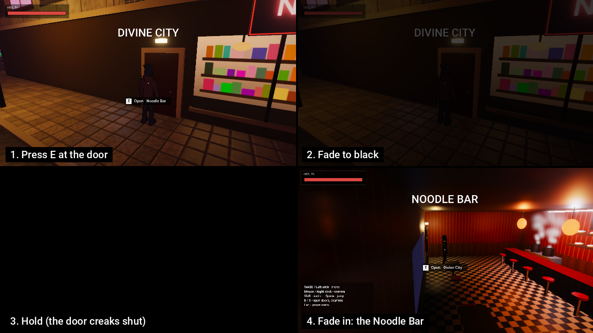

Walk up to a door and press **E** (gamepad **X**). The screen fades to black, the door creaks shut while it's dark, and you fade in on the other side, like the doors in the original *Resident Evil*. Some doors lead to other scenes, one leads to a hotel roof in the same scene, and most are locked, each with its own excuse. Apartment 9 needs a key, and the key is somewhere in the Noodle Bar. You can also examine things (a payphone, a poster, a vending machine) for a line of text.

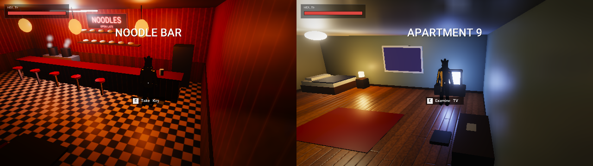

*Interiors use a fixed corner camera that only turns to follow you.*

The subway goes to **Ember Isle**, a procedurally generated island where you collect embers, avoid the shades that hunt you and save at campfires. Its portal leads to a physics playground, whose portal brings you back to the city. The game can be played solo or with a friend over the network.

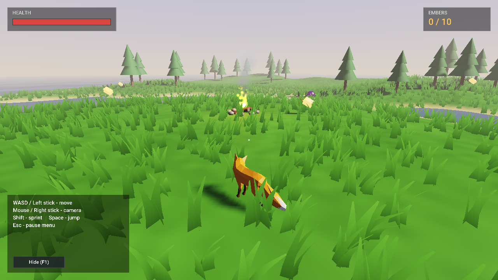

Everything in the demo, from the buildings to the textures and the door sounds, is generated by code in this repository: [`game/src/CityBuilder.cpp`](game/src/CityBuilder.cpp), [`tools/textures/make_city_textures.py`](tools/textures/make_city_textures.py) and [`tools/audio/make_city_sounds.py`](tools/audio/make_city_sounds.py).

## Features

| System | What's implemented |
|---|---|
| **Rendering** | Forward **PBR** renderer (Cook-Torrance GGX, metallic/roughness, normal/occlusion maps) in **HDR**; **cascaded shadow maps** with soft Poisson PCF; sky lighting via spherical harmonics; time-sliced **reflection cubemap**; post stack with **SSAO, bloom, ACES filmic tone mapping, color grading, FXAA**; **progressive GPU path tracer** (BVH, next-event estimation, accumulation); **toon/cel shading** with **inverted-hull ink outlines**; 8 point + 4 spot lights, procedural sky, fog, frustum culling, **automatic batching** of identical meshes, GPU skinning, entity-ID picking |
| **Entity Component System** | Custom sparse-set ECS with versioned handles, stable component storage, multi-component views, parent/child hierarchy |
| **Input** | Keyboard, mouse, up to 4 gamepads, named actions & axes, runtime rebinding with JSON persistence |
| **Scenes** | Human-readable JSON scenes, scene switching at safe points, deep entity duplication with UUID remapping |
| **Assets** | glTF/GLB (meshes, materials, skins, animations), OBJ, FBX, PNG/JPG/TGA, WAV/MP3/FLAC; caching and hot reload on file change |
| **Scripting** | C++ gameplay scripts with lifecycle callbacks (`OnCreate`, `OnUpdate`, `OnFixedUpdate`, `OnLateUpdate`, collision/trigger events, `OnGUI`) and reflected fields editable in the inspector; **events and timers** (`On`, `Emit`, `Invoke`); no-code **Event Trigger** rules ("when this happens → do that") and a live **Event Log** |
| **Interaction** | **Screen fades** that carry across scene loads; **doors** (to another scene or a spawn point in the same one, locked, or opened by a key item), things to **examine** and **pick up**, an on-screen prompt for whatever the player faces; fixed corner and orbit cameras |
| **Physics** | Impulse solver with friction & restitution, sphere and oriented-box colliders, heightfield terrain collision, triggers, raycasts, overlap queries, kinematic bodies, sort-and-sweep broad phase, fixed 60 Hz timestep |
| **Animation** | Skeletal animation with slerp sampling, cross-fades, 1D blend spaces with phase sync, parameter-driven state machines, root motion, one-click locomotion setup from clip names (Blender/Mixamo) |
| **Audio** | miniaudio backend, 2D and 3D spatial sound, streamed music, master/music/SFX buses, listener component |
| **Terrain** | Procedural fBm heightmaps, in-editor sculpting (raise/lower/smooth/flatten), height/slope-based texturing, wind-animated instanced grass, scattered trees, animated water |
| **Game UI** | Immediate-mode HUD API (panels, text, buttons, progress bars, images, world-space labels) plus retained UI components editable in the editor |
| **Navigation & AI** | Grid nav-mesh baking from terrain and colliders, A* with path smoothing, nav agents, finite state machines, behaviour trees |
| **Particles** | CPU simulation, instanced billboards, additive/alpha blending with sorting, presets (fire, smoke, sparks, magic, rain, dust) |
| **Debugging** | CPU profiler with per-system timings, frame-time graph, draw/triangle/memory stats, debug line drawing, collider and nav-grid overlays |
| **Projects** | Project Hub with templates (Empty, 3D Starter, sample copy), recent projects, in-editor folder browser, switching projects with save prompts |
| **Build / Export** | Packages the runtime, engine data and project into a standalone folder from the editor or the command line |
| **Save system** | Key/value save slots, checkpoints that snapshot every `Saveable` entity, restore across scene reloads |
| **Networking** | Client/server over UDP with handshake, timeouts, ping, transform replication with interpolation, remote player spawning, custom JSON messages |
| **Tests & CI** | 35 headless unit tests (CTest) covering ECS, serialization, transform cache, physics, terrain, navigation, AI, animation, locomotion setup, input, saves, toon outline normals, the ray-tracing BVH, events/triggers, screen fades and doors; GitHub Actions builds on Windows and Linux |

## Getting started

### Requirements
- CMake 3.16+
- A C++17 compiler: **Visual Studio 2022**, GCC 9+ or Clang 10+
- A GPU with OpenGL 3.3
- Linux only: `sudo apt install build-essential cmake libx11-dev libxrandr-dev libxinerama-dev libxcursor-dev libxi-dev libgl-dev`

All third-party libraries are vendored in `third_party/`, so no package manager or internet connection is needed.

### Build

**Windows (Visual Studio 2022)**
```bat
cmake -S . -B build
cmake --build build --config Release
build\bin\euphoria-editor.exe
```
Or open the folder in Visual Studio ("Open a local folder") and pick `euphoria-editor.exe` as the startup item.

**Linux**
```bash
cmake -S . -B build -DCMAKE_BUILD_TYPE=Release
cmake --build build -j
./build/bin/euphoria-editor
```

Run the tests with `ctest --test-dir build -C Release --output-on-failure`.

### Create a project
Launching `euphoria-editor` opens the **Project Hub**:

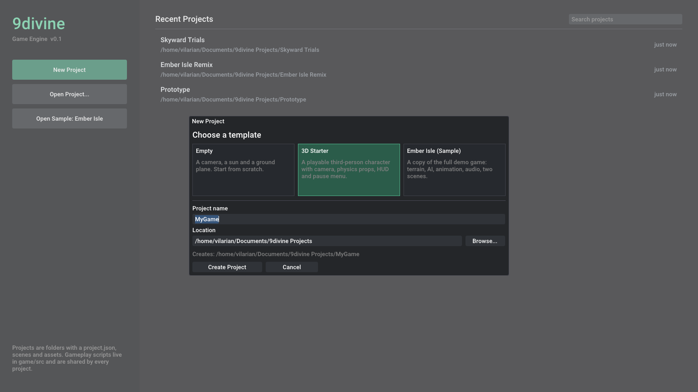

- **New Project** – pick a template, a name and a folder (defaults to `Documents/Euphoria Projects`):
  - **Empty** – camera, sun and a ground plane.
  - **3D Starter** – a playable third-person character with camera, physics props, HUD and pause menu.
  - **Divine City (Sample)** – your own editable copy of the full demo game.
- **Open Project...** – browse to any folder that contains a `project.json`.
- **Recent Projects** – click to reopen; right-click to show in the file browser or remove from the list.

Inside the editor, **File → New Project / Open Project / Recent Projects / Close Project** switch projects (you're asked to save unsaved changes first).

A project is a folder with `project.json`, `input.json`, `Scenes/`, `Models/`, `Textures/` and `Audio/`. Gameplay scripts are C++ in `game/src` and are available to every project.

### Play the demo
- **Editor:** click **Open Sample: Divine City** in the hub (or run `euphoria-editor projects/Demo`). Press **Play** (Ctrl+P).
- **Standalone:** `euphoria-player` runs the game directly.
- **Multiplayer:** start one copy with `euphoria-player --host` and another with `euphoria-player --join 127.0.0.1` (or use the in-game pause menu).

| Action | Keyboard / Mouse | Gamepad |
|---|---|---|
| Move | WASD | Left stick |
| Camera | Mouse | Right stick |
| Jump / Sprint | Space / Shift | A / L3 |
| Open doors / examine | E | X |
| Launch ball (arena) | Left click | RT |
| Pause menu | Esc | Start |
| Stats overlay / Screenshot | F3 / F12 | |
| Toggle ray tracing | F4 | |

### Editor controls
| | |
|---|---|
| Fly camera | Hold right mouse + WASD/QE (wheel changes speed) |
| Orbit / Pan / Zoom | Alt + left drag / middle drag / wheel |
| Gizmos | Q none, W move, E rotate, R scale (Ctrl to snap) |
| Focus selection | F or double-click in the hierarchy |
| Undo / Redo | Ctrl+Z / Ctrl+Y |
| Duplicate / Delete | Ctrl+D / Del |
| Save scene | Ctrl+S |
| Release mouse from a running game | Shift+Esc |

## Writing gameplay code

Scripts are C++ classes in `game/src`. Every `.cpp` there is compiled into both the editor and the player, and `EU_SCRIPT` registers the class so scenes can reference it by name.

```cpp
#include <euphoria/Euphoria.h>
using namespace eu;

class Coin : public ScriptableEntity {
public:
    float spinSpeed = 120.0f;                       // shows up in the inspector

    void Reflect(FieldVisitor& v) override { v.Float("Spin Speed", spinSpeed); }

    void OnUpdate(float dt) override {
        Transform().rotation *= glm::angleAxis(glm::radians(spinSpeed * dt), vec3(0, 1, 0));
    }

    void OnTriggerEnter(Entity other) override {
        if (other.Get<TagComponent>().tag != "Player") return;
        Audio::PlayOneShot("Audio/coin.wav");
        SaveGame::SetInt("coins", SaveGame::GetInt("coins") + 1);
        DestroySelf();
    }

    void OnGUI() override {
        UI::Text({ 40, 40 }, "Coins: " + std::to_string(SaveGame::GetInt("coins")), 36);
    }
};
EU_SCRIPT(Coin)
```

Then add a **Scripts** component in the inspector and pick `Coin`. See [`game/src`](game/src) for complete examples: a third-person controller, an orbit camera, a state-machine enemy, a behaviour-tree animal, checkpoints and a ball launcher.

### Events and timers

Scripts can talk to each other without holding references, and schedule work for later:

```cpp
void OnCreate() override {
    On("OpenGate", [this](const Event&) { Get<MeshRendererComponent>().emissive = vec3(0.0f); });
    InvokeRepeating(0.0f, 1.0f, [this] { Emit("Tick", { { "time", GetScene().Events().Time() } }); });
}
void OnTriggerEnter(Entity other) override {
    if (other.Get<TagComponent>().tag == "Player") Emit("OpenGate");
    Invoke(3.0f, [this] { DestroySelf(); });
}
```

Events are queued and delivered after scripts and physics have run each frame. A script's listeners and timers are removed automatically when its entity is destroyed.

### Event Triggers (no code)

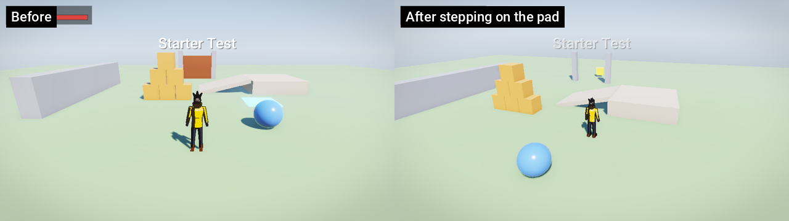

Add an **Event Trigger** component and build rules in the inspector: *when* (game starts, something enters/exits a trigger, collision, an event, a timer, an input action) → *do* (emit an event, move/rotate something over time, show/hide, destroy, play a sound, send a message, load a scene, log). Rules can have a delay and run once. The **3D Starter** template's glowing pad that lowers a gate is built this way. Open **Window → Event Log** while playing to see every event, who sent it and how many listeners heard it.

### Doors, interaction and screen fades

`ScreenFade` is part of the engine. A fade keeps running while the scene underneath it changes, so a scene load can happen while the screen is black:

```cpp
// Fade out over 0.45 s, run the lambda once the screen is black, hold for 1.1 s, fade in over 0.6 s
ScreenFade::Transition(0.45f, 1.1f, 0.6f, [] { SceneManager::LoadScene("Scenes/Basement.scene"); });
```

The demo's `Door`, `Examine` and `Interactable` scripts ([`game/src/Interaction.h`](game/src/Interaction.h)) use it. Put a `Door` on any entity and fill in its fields:

| Field | |
|---|---|
| Target Scene | scene to load; leave empty to stay in this scene |
| Spawn Point | name of the entity to place the player at (the player faces the way it faces) |
| Locked / Locked Message | a locked door shows its message and plays a rattle |
| Key Item | the door unlocks once the player holds this item (an `Examine` with **Give Item** hands it out) |
| Fade Out / Hold / Fade In | timing of the transition |

The player shows a prompt for the closest interactable in front of it and uses it with the **Interact** input action. To make your own kind of usable object, derive from `Interactable` and override `Verb()` and `Interact()`. Event Triggers can use any of them too, with a **Send Message** action whose message is `Interact`.

## Architecture

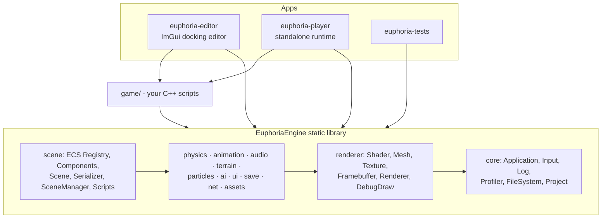

A frame of the running game:

```mermaid
flowchart LR
    A[Poll input] --> B[Scripts<br/>OnUpdate]
    B --> C[Fixed steps @ 60 Hz<br/>OnFixedUpdate + physics<br/>+ collision events]
    C --> D[Navigation agents]
    D --> E[Animators]
    E --> F[OnLateUpdate<br/>cameras]
    F --> F2[Events + timers<br/>trigger rules, tweens]
    F2 --> G[Particles, audio,<br/>network sync]
    G --> H[Deferred destroys]
    H --> I[Cascaded shadows<br/>+ 1 reflection face]
    I --> J[HDR main pass:<br/>sky, PBR meshes, terrain,<br/>foliage, water, particles]
    J --> J2[Post: SSAO, bloom,<br/>tone map, grade, FXAA]
    J2 --> K[Game UI]
```

A deeper walkthrough of each subsystem and the design decisions behind it is in **[docs/ARCHITECTURE.md](docs/ARCHITECTURE.md)**.

## Repository layout

```
engine/src/euphoria/      the engine (core, scene, renderer, physics, animation, audio, ai, ...)
editor/src/         the editor application
player/src/         the standalone runtime used by exported games
game/src/           gameplay scripts + the demo project generator
assets/             engine shaders and fonts
projects/Demo/      the sample project: Divine City, its interiors, Ember Isle and the arena
tests/              unit tests
tools/blender/      the Hero character generator (Blender script / standalone)
tools/textures/     generators for the city textures and the demo's normal maps
tools/audio/        generator for the city's sound effects
third_party/        vendored libraries
docs/               architecture notes, roadmap, screenshots
```

## Command line

| Command | |
|---|---|
| `euphoria-editor` | Open the Project Hub |
| `euphoria-editor [projectDir]` | Open a project (an empty or new folder becomes an Empty project) |
| `euphoria-editor --new-project` | Open the hub straight to the New Project dialog |
| `euphoria-editor --create-project <dir> [--template empty\|starter\|sample] [--name "My Game"]` | Create a project from a template and open it |
| `euphoria-editor --play` | Open and immediately enter play mode |
| `euphoria-editor [projectDir] --export <dir>` | Build a standalone game without opening the editor |
| `euphoria-player [projectDir]` | Run a project |
| `euphoria-player --host [port]` / `--join <ip> [port]` | Start or join multiplayer |
| `euphoria-player --build-demo <dir>` | Regenerate the sample project |
| `euphoria-player --ray-traced` | Start in path-traced rendering (F4 toggles) |
| `euphoria-player --scene Scenes/Island.scene` | Start in another scene of the project |
| `--width W --height H --fullscreen --no-vsync` | Window options |
| `--screenshot file.png --screenshot-frame N` | Save frame N and exit (automated testing) |
| `--fixed-dt 0.0166` | Advance exactly this many seconds per frame, so screenshots are deterministic |

## Roadmap

Ideas for what comes next are in [docs/ROADMAP.md](docs/ROADMAP.md) — including rotational rigid-body dynamics, deferred/PBR rendering, a recast-style polygon nav mesh, binary network snapshots with client-side prediction, and C# scripting.

## Credits

- Fox model by PixelMannen (CC0), rigging & animation by tomkranis (CC BY 4.0), glTF conversion by @AsoboStudio and @scurest (CC BY 4.0) — from the Khronos [glTF Sample Assets](https://github.com/KhronosGroup/glTF-Sample-Assets) (`Models/Fox`). License file: `projects/Demo/Models/Fox/LICENSE.md`.
- Hero character: original, generated by `tools/blender/euphoria_hero.py` (MIT, like the rest of the repo).
- Fonts: Roboto and Cousine (Apache License 2.0), bundled with Dear ImGui.
- Sounds, textures and terrain in the demo are generated procedurally.
- Libraries: GLFW, glad, GLM, Dear ImGui, ImGuizmo, stb, cgltf, tinyobjloader, ufbx, miniaudio, nlohmann/json. See [THIRD_PARTY_NOTICES.md](THIRD_PARTY_NOTICES.md).

## License

[MIT](LICENSE)
