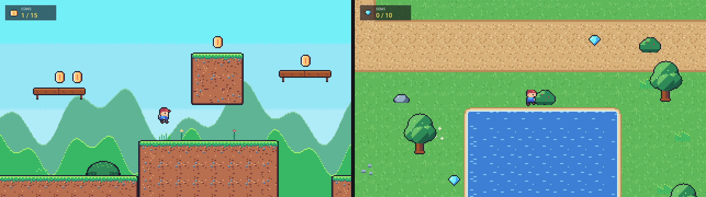
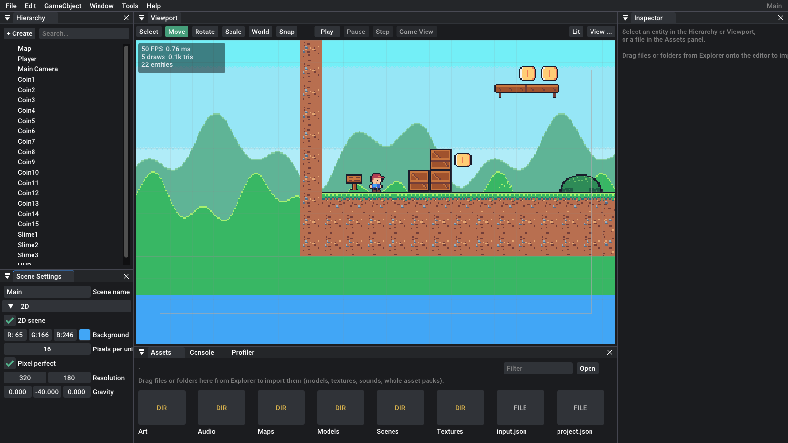

# Making 2D games

Euphoria can make flat 2D games with pixel art: platformers, top-down adventures, RPGs. You get sprites, sprite-sheet animation, tilemaps made in [Tiled](https://www.mapeditor.org), crisp pixel-perfect scaling, 2D physics and a 2D mode in the editor.



## Start from a template

In the Project Hub, choose **New Project**, then one of these templates:

- **2D Platformer**: a side scroller. The hero runs and jumps, with coyote time, jump buffering and a shorter hop when you let go early. There are coins to collect, slimes to stomp and a parallax sky.
- **2D Top-Down**: a small village to walk around in four directions, with a house, a pond with animated water, trees to walk behind and gems to find.

You can also create them from the command line:

```
euphoria-editor --create-project MyGame --template platformer2d
euphoria-editor --create-project MyGame --template topdown2d
```

Everything in the templates is yours to change. The art lives in `Art/` and the levels in `Maps/` (open the `.tmx` files in Tiled). The scripts are `PlayerController2D`, `CameraFollow2D`, `Collectible2D`, `Patrol2D` and `Hud2D`, found in [`game/src/Scripts2D.cpp`](../game/src/Scripts2D.cpp). The art was drawn by code, in [`tools/pixelart/make_2d_starter.py`](../tools/pixelart/make_2d_starter.py).

## Turning a scene into a 2D scene

Open **Scene Settings → 2D** and tick **2D scene**. Then:

| Setting | What it does |
|---|---|
| **Background** | The color behind everything |
| **Pixels per unit** | How many image pixels make one world unit. Use your tile size: 16 for 16×16 tiles. One tile is then 1 unit, which keeps physics and scripts readable |
| **Pixel perfect** | The game draws at a low resolution and is scaled up by a whole number. Every art pixel becomes the same size square on screen, and nothing shimmers when the camera moves |
| **Resolution** | How many art pixels fit on screen in pixel-perfect mode, e.g. 320×180, 480×270 or 640×360. The window gets the largest whole-number scale that fits, and any extra space shows a bit more of the world. There are no black bars |
| **Gravity** | Use about (0, -40, 0) for a platformer and (0, 0, 0) for a top-down game |

In a 2D scene the world is the XY plane with +Y up. Lighting, shadows and post effects are switched off, so the colors in your images are the colors on screen. Physics keeps bodies in their plane.

The editor's scene view then looks straight at the plane:
- Drag with the right or middle mouse button to pan.
- Use the mouse wheel to zoom at the cursor.
- Press **F** to frame the selected object.

The grid is one unit (one tile) per square. A white rectangle shows what the game camera will see.



## Sprites

Drag an image from the Assets panel (or from Explorer) into the 2D viewport and you get a sprite at that spot. You can also use **GameObject → 2D → Sprite**.

**Sprite Renderer** settings:
- **Image** and **Region**: the region is the part of the image to show (x, y, width, height in pixels from the top-left). A width of 0 shows the whole image.
- **Pivot**: the point on the sprite that sits on the object's position. Use *Feet* for characters, so they stand on things and sort correctly.
- **Color**: a tint, and its alpha fades the sprite.
- **Flip X / Flip Y**.
- **Order**: higher draws on top.
- **Y-sort**: within the same order, sprites lower on screen draw in front. This is what lets a character walk behind a tree and then in front of it.

### Sprite sheets and animation

When you drop a **sprite sheet**, the engine works out the frame size by itself and adds a **Sprite Animator** that plays all the frames. It handles three kinds of sheet:
- Frames separated by transparent gaps.
- Frames that touch.
- A grid with several rows.

The Assets panel draws the detected frame grid over the image.

An **animation** is a run of frames from a sheet, read left to right and top to bottom. Each one has:
- a **name**
- a **sheet**
- a **frame size** (0 means detect it)
- a **first frame** and a number of **frames** (0 means to the end of the sheet)
- **FPS** and **loop**

The inspector previews each animation as it plays. **Split sheet rows into animations** makes one animation per row, which suits a character with a row per direction.

From a script:

```cpp
auto& anim = Get<SpriteAnimatorComponent>();
anim.Play("run");                    // keeps playing if it already is
anim.Play("attack", true);           // restart
if (anim.finished) anim.Play("idle"); // a non-looping animation reached its end
```

`PlayerController2D` picks animations by name, ignoring case. It looks for `idle`, `run` (or `walk`), `jump` and `fall`. Top-down sheets use a direction suffix: `walk_down`, `walk_up`, `walk_left`, `walk_right`. If `_left` is missing, the controller uses the `_right` animation mirrored, and the other way round.

## Tilemaps (Tiled)

Make maps in **Tiled** and drop the `.tmx` (or `.tmj`) file into the viewport. The engine copies the map's tilesets and images too, keeping their folders. You can also add a **Tilemap** component and pick the map. When you save in Tiled, the map reloads in the editor and in a running game.

The map's bottom-left corner sits at the entity's position.

**What's supported:**
- Orthogonal maps, finite or infinite.
- Tile data as CSV or Base64, compressed with zlib or gzip or not compressed. Zstandard isn't supported; save the map as CSV instead.
- Embedded and external tilesets (`.tsx` and `.tsj`), both atlas tilesets and image collections.
- Tile offsets, margins and spacing.
- Flipped and rotated tiles.
- Animated tiles.
- Groups: their opacity, tint, offset, visibility and parallax apply to the layers inside.
- Image layers, including **repeat X/Y** and **parallax**, for skies and backgrounds.
- Object layers. Tile objects are drawn (scaled and rotated). Points, rectangles, polygons and the other shapes are kept for scripts.
- Custom properties.

**What's not supported yet:** isometric and hexagonal maps (they're drawn as if orthogonal), object templates (`.tx`), Wang/terrain auto-tiling at runtime, and text objects.

### Drawing order

Sprites draw at **order 0**. Tiled layers are placed around them like this:
- The **last object layer that holds tile objects** (trees, houses, props) is where characters walk. It gets order 0 and is y-sorted together with your sprites.
- Layers below it in Tiled draw under the characters.
- Layers above it draw over them, which is right for roofs and treetops.
- In a map without such an object layer, every layer draws under the sprites, except layers whose name contains *above*, *front*, *fore*, *overhead* or *roof*.

Any layer can override this with Tiled custom properties:

| Property | Type | Effect |
|---|---|---|
| `order` | int | The layer's drawing order (sprites are at 0) |
| `ysort` | bool | Y-sort this layer's tiles and objects with the sprites |
| `collision` | bool | Every tile in the layer is solid, even if the layer is hidden |

### Collision

Draw collision shapes on tiles in Tiled's **tile collision editor**. Every placed tile then becomes solid in those shapes: rectangles as they are, and polygons and ellipses as their bounding boxes.

There are also two whole-layer shortcuts:
- A tile layer named `Collision`, `Solid` or `Walls` is solid everywhere it has tiles (or set `collision = true` on any layer).
- Rectangles in an object layer with one of those names are solid. So is any object whose class is `collision`, `solid` or `wall`.

Touching collision boxes are merged into bigger ones, so a long floor is one box. That keeps characters from snagging on the seams between tiles. Turn on **View → Colliders** in the editor to see the boxes.

### Objects for scripts

```cpp
// In a script: where is the map's "PlayerStart" point in the world?
Entity mapEntity = Find("Map");
TilemapData* map = EnsureTilemapLoaded(mapEntity.Get<TilemapComponent>());
if (const TilemapObject* spawn = map ? map->FindObject("PlayerStart") : nullptr) {
    vec2 local = map->MapToLocal({ spawn->x, spawn->y }, GetScene().Environment().pixelsPerUnit);
    vec3 world = vec3(GetScene().WorldMatrix(mapEntity) * vec4(local, 0.0f, 1.0f));
}
```

The templates place their coins, gems and slimes on point objects in the map, so you can move them around in Tiled.

## Characters and physics

A 2D character needs these components:
- a **Sprite Renderer** with the pivot at the feet
- a **Sprite Animator**
- a **Dynamic Rigid Body** with friction 0
- a **Box Collider** sized to the body, with its offset raised by half its height

Tag it `Player` and add **PlayerController2D**. Tick **Top Down** for 8-way movement; leave it off for platformer controls.

The physics is the engine's normal physics, kept in the XY plane. That means collision events, triggers, raycasts and `grounded` all work as they do in 3D. Use a **trigger** Box Collider for pickups and zones.

Put **CameraFollow2D** on the camera. It follows the player smoothly, looks ahead in the direction of travel, stops at the map's edges and cuts instantly when the player respawns.

## Tips

- Keep all your art at one pixel density: if tiles are 16 px, draw characters at the same scale.
- Images used by sprites and tilemaps are loaded with nearest-neighbour filtering, so pixels stay sharp in the editor too.
- The game view in the editor is pixel perfect just like the exported game. Resize the editor to see how the scale changes.
- `euphoria-player MyGame --simulate-input "D@0.5-3,Space@1-1.3"` holds keys at set times. That's handy for automated tests and for screenshots.
