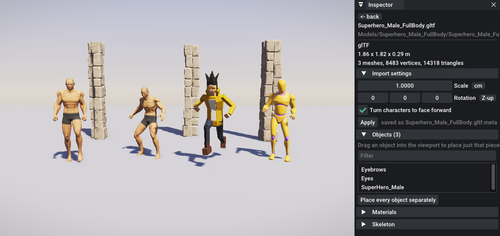

# Using models, asset packs and Blender files

The engine opens the formats asset stores and Blender give you, finds their textures even when the paths inside the files are wrong, and plays animations from one file on characters from another.



*Quaternius' Universal Base Characters (glTF and FBX), the Universal Animation Library's own mannequin, and the demo's Hero, all playing clips from the Universal Animation Library, next to pieces of the Medieval Village MegaKit. On the right, the Inspector showing an imported model.*

## Supported formats

| Format | What's imported |
|---|---|
| **glTF / GLB** | Meshes, PBR materials (color, normal, metallic-roughness, occlusion, emissive), every skin, skeleton, all animations, embedded or external textures |
| **FBX** | Meshes, materials (color, normal, emissive, roughness, metallic, embedded or on disk), skinned characters, every animation take, meshes parented to bones (a sword in a hand). Units and axes are converted to metres and Y-up |
| **OBJ** | Meshes, one object per `o`/`g` group, `.mtl` materials and their maps |
| **.blend, .dae, .3ds, .stl, .ply, .usd, Alembic** | Through the Blender installed on your computer (see below) |
| Textures | PNG, JPG, TGA, BMP, PSD, GIF |
| Sound | WAV, MP3, FLAC |

## Importing

**Drag files or folders from Explorer (or Finder) onto the editor.**
- **A whole asset pack folder** is copied into `Models/` as it is. Packs usually keep `Models/` and `Textures/` folders side by side, and that layout is what the texture finder looks for.
- **A single model** gets its own folder with everything it uses: glTF `.bin` files and images, OBJ `.mtl` files and their maps, and the textures an FBX points to.
- **Textures and sounds** go into `Textures/` and `Audio/`.
- **Dropped on the viewport**, a single model is also placed where the mouse is.

The same thing from a terminal:

```
euphoria-editor MyGame --import "C:\Users\me\Downloads\Survival" --import Character.fbx
```

**Click a model** in the Assets panel to inspect it. The Inspector shows:
- format, size, vertex and triangle counts
- import settings
- the objects inside the file
- each material's textures (ones that couldn't be found are in red)
- the skeleton, with the humanoid bones the engine recognised
- the animations

`euphoria-player --model-info <file>` prints the same report without opening anything. Add `--retarget <animation file>` to also see how that file's skeleton maps onto this one.

## When textures are missing

Files from asset stores often point at textures with paths from the artist's computer, such as `C:\Users\artist\Desktop\char.png`. The engine searches by file name instead, in this order:
1. The path as written.
2. The model's folder.
3. A `Textures` / `textures` / `Materials` / `Images` folder beside the model.
4. The parent folder and its `Textures` folder, then two levels up.
5. Anywhere below the grandparent folder (a bounded search).

It ignores letter case. It also fixes common exporter quirks: `Hair_Normal_png.png` finds `Hair_Normal.png`, and a `.tif` or `.dds` finds a `.png` with the same name.

When a material only has a color texture, other maps are picked up by name from the same folder:

| Color texture | Also uses |
|---|---|
| `Barrel.png` | `Barrel_n.png` / `Barrel_Normal.png` / `Barrel_nrm.png` (normal), `Barrel_Emissor.png` / `Barrel_Emissive.png` (glow) |
| `T_Brick_BaseColor.png` | `T_Brick_Normal.png`, `T_Brick_ORM.png` (occlusion-roughness-metal), `T_Brick_Roughness.png`, `T_Brick_Metallic.png`, `T_Brick_AO.png` |
| `T_Hero_Dark.png` | `T_Hero_Normal.png` (the last `_part` is treated as a variant) |

If a texture still doesn't show, the Inspector's Materials list says which file the model asked for.

## Kits: one file, many props

Packs such as *Survival* or *Objects Interior* put dozens of props in one file. Click the file, then open **Objects** in the Inspector:
- **Drag an object** into the viewport to place just that piece, centred on its own pivot.
- **Place every object separately** to get one entity per object, laid out as in the file.

In scenes and code the path is `Models/Survival/Models/Survival.fbx#Axe`.

## Characters and animation libraries

A character can play animations stored in other files: an animation library like Quaternius' *Universal Animation Library*, Mixamo downloads, or another character's clips.

1. Place the character. Rigged models without animations get an empty Animator.
2. Drag the animation file from the Assets panel onto **Animator → Animations from**.
3. Its clips now appear in the Animator's lists. **Auto-setup locomotion** picks the idle, walk, run, jump and fall clips by name (`Idle_Loop`, `Walk_Loop`, `Jog_Fwd_Loop`, `Jump_Start`, `Jump_Loop`, Mixamo's `Walking`, `Running`, ...). Variants such as crouching, pistol or swimming clips are only used when nothing else fits.

How the clips are moved onto your character:
- **Same skeleton** (a library made for that rig): the keys are copied, and the character keeps its own bone lengths.
- **Different skeleton**: joints are matched through a humanoid skeleton. The bones are hips, spine, chest, neck, head, shoulders, arms, hands, legs, feet and toes. The matcher understands Mixamo (`mixamorig:LeftUpLeg`), Unreal (`thigh_l`), Blender and Rigify (`thigh.L`, `DEF-thigh.L`) and similar naming. Each bone then copies how far the source bone turns from its rest pose. Rigs bound in a T-pose and in an A-pose are lined up bone by bone, and hip motion is scaled by hip height.
- **Facing**: characters that face backwards (common with FBX) are turned to face +Z on import, so all characters and their animations agree. Untick *Turn characters to face forward* in the import settings if one ends up backwards.

Retargeting moves the body, not fingers or faces. Both rigs should be humanoid and rest in roughly the same pose.

## Blender files

Put a `.blend` straight into your project. The engine finds the installed Blender and exports the file to glTF in the background. The editor keeps running, and the model appears when the export finishes, usually a few seconds. Saving the `.blend` again re-exports it.

The engine looks for Blender in this order:
1. The `EUPHORIA_BLENDER` environment variable.
2. The Blender path set in the editor (click a `.blend` in the Assets panel).
3. `C:\Program Files\Blender Foundation\Blender x.y` (the newest version).
4. A Steam install.
5. Your `PATH`.

Converted models are kept in your project's `.euphoria/converted/` folder and included when you build the game, so players never need Blender.

The same route opens **Collada (.dae)**, **.3ds**, **.stl**, **.ply**, **.usd** and **Alembic**. Blender 5 removed Collada; if a pack also ships an `.fbx` or `.glb`, use that instead.

If the textures are separate files rather than packed into the `.blend` (*File → External Data → Pack Resources*), import the whole folder so the relative paths still work.

## Import settings

Saved next to the model as `<file>.meta`:

| Setting | When to use it |
|---|---|
| Scale | A model is 100× too big: an export in centimetres without unit conversion (the **cm** button sets 0.01) |
| Rotation | A model lies on its back: a Z-up export (the **Z-up** button sets -90° X) |
| Turn characters to face forward | On by default; untick for a character that ends up backwards |

## Troubleshooting

| Symptom | Fix |
|---|---|
| Model is pink, white or untextured | Click it: the Materials list shows which texture file is missing. Import the pack's `Textures` folder too |
| Huge or tiny | Set Scale in the import settings (0.01 for centimetres) |
| Lying down | Rotation -90° on X |
| Character doesn't animate | Rigged models without clips need an animation file under *Animations from* |
| Arms twist oddly on a retargeted clip | The rigs rest in very different poses. Use clips made for that rig, or export the character in a T-pose |
| ".blend: Install Blender (or set its path)" | Install Blender, or click the file and enter the path to `blender.exe` |
| Collada file won't open | Your Blender has no Collada importer (Blender 5). Use the pack's `.fbx` or `.glb` |
