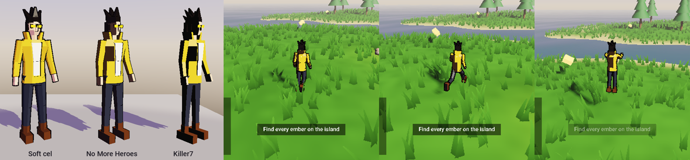

# Characters from Blender

Euphoria Engine plays rigged, animated glTF characters. A Blender character with actions named **Idle**, **Walk**, **Run** and **Jump** becomes a walkable player with one click. The playable Hero in Ember Isle and the 3D Starter is built this way.



## The Hero

`tools/blender/euphoria_hero.py` builds the Hero from code: a ~700-triangle faceted human with a 17-bone rig and four actions. The same file runs in two ways.

**In Blender (3.6 or 4.x)**, it builds a real, editable mesh, armature, materials and actions, then exports `Hero.glb`:

- *Scripting* tab → *Open* → `tools/blender/euphoria_hero.py` → *Run Script*, or
- `blender --background --python tools/blender/euphoria_hero.py -- path/to/Hero.glb`

After that, it's an ordinary Blender scene. Reshape the mesh, recolor the `Hero_*` materials, or tweak the actions in the Action Editor. Then export it yourself with the settings below.

**Without Blender**, `python3 tools/blender/euphoria_hero.py` writes the same GLB directly to `projects/Demo/Models/Hero/Hero.glb`. Edit `build_parts()` (geometry) or the `_idle` / `_walk` / `_run` / `_jump` pose functions (animation) and run it again.

## Making your own character

### Modelling and rigging
- Model in metres (the default unit) with the feet at the origin, **facing -Y** (Blender's *Front* view, numpad 1). The exporter turns that into glTF's +Z.
- Rig it with an armature. Any bone names work. Auto weights (*Ctrl+P → With Automatic Weights*) are fine, and so is weighting every vertex to a single bone, which is how the Hero gets its rigid PS2-era look.
- Apply the object's scale and rotation (*Ctrl+A → All Transforms*) before animating.

### Actions
Make one action per motion and name them so the engine can find them:

| Engine state | Action names it looks for (case-insensitive, `Armature\|` prefix ignored) |
|---|---|
| Idle | `Idle`, `Survey`, `Stand`, `Breath…` |
| Walk | `Walk…` |
| Run | `Run…`, `Jog…`, `Sprint…` |
| Airborne | `Fall…` / `Air…` (loops), otherwise `Jump…` (plays once and holds the last pose) |

- Make walk and run cycles **in place** (no forward root motion). Make them loop seamlessly, with the last frame matching the first.
- Give each action a **fake user** (the shield icon), or push it to an NLA track, so it gets exported even when it isn't the active action.
- Note how fast each cycle moves, in metres per second (stride length × cycles per second). The blend space uses those speeds to keep feet from sliding. The Hero's walk is tuned for 2 m/s and its run for 6 m/s.

### Export
The quickest way is no export at all: save the `.blend` into your project's `Models/` folder. The engine runs your Blender in the background to convert it, and re-converts every time you save (see [ASSETS.md](ASSETS.md#blender-files)).

To export by hand, use *File → Export → glTF 2.0* (FBX works too):

- **Format:** glTF Binary (`.glb`)
- **Include:** Selected Objects (select the armature and the mesh)
- **Transform:** +Y Up ✔
- **Data → Mesh:** Apply Modifiers off (the armature modifier must stay live)
- **Animation:** ✔, mode **Actions**. Skinning ✔

Save it into your project's `Models/` folder (for example `Models/MyHero/MyHero.glb`). The editor hot-reloads it when the file changes, so you can re-export while the editor is open.

### Make it the player
1. Select the player's model child (named `PlayerModel` in the templates). Drag your `.glb` onto **Mesh Renderer → Mesh**.
2. Set its rotation to **Y 180°**, because Blender's front faces +Z and the engine's forward is -Z.
3. Under **Animator**, click **Auto-setup locomotion**. This builds:
   - `Locomotion`: a blend space on `Speed`, going idle (0) → walk (2 m/s) → run (6 m/s). Edit the thresholds to match your cycle speeds.
   - `Airborne`: entered when `Grounded` turns false and left when it turns true again.
4. On the player entity, set **PlayerController → Model** to that child. The controller feeds `Speed` and `Grounded` every frame.
5. Optional: tick **Toon shading** and pick a preset (*Soft cel*, *No More Heroes* or *Killer7*).

From code, the same steps look like this (see `game/src/Characters.cpp`):

```cpp
Entity model = scene.CreateEntity("PlayerModel");
model.Transform().parent = player.GetUUID();
model.Transform().SetEulerDegrees({ 0, 180, 0 });
auto& mr = model.Add<MeshRendererComponent>();
mr.mesh = "Models/MyHero/MyHero.glb";
ApplyToonPreset(mr, ToonPreset::Killer7);
SetupLocomotion(model.Add<AnimatorComponent>(), { "Idle", "Walk", "Run", "Jump" }, 2.0f, 6.0f);
```

## Troubleshooting

| Symptom | Fix |
|---|---|
| Only one animation plays | The other actions weren't exported. Give them fake users, or use Animation mode *Actions*. |
| Character walks backwards | Set the model's Y rotation to 180° (or 0° if you modelled it facing +Y). |
| Tiny or huge | Apply scale in Blender (*Ctrl+A*). Engine units are metres. |
| Mesh explodes when animated | Apply transforms *before* parenting to the armature, then re-parent. |
| Feet slide | Change the Walk/Run thresholds in the Locomotion state to the speed your cycles actually move at. |
| "No idle/walk/run clips found" | Rename the actions using the table above, or play clips from an animation library (Animator → *Animations from*, see [ASSETS.md](ASSETS.md#characters-and-animation-libraries)). |
